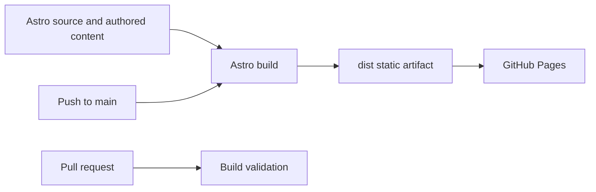

# Architecture

**Status:** Proposed foundation, scaffolded for owner review. The decisions below are not approval to proceed into visual design or final content.

## Purpose

Establish a static, accessible, maintainable professional and research site for Dr. Chin. The site should communicate quantum systems, software and platform architecture, infrastructure, and research through clear information structure. This foundation contains no biography or project claims.

## Deployment model

- GitHub Pages serves generated static files; there is no request-time server, database, or backend.
- GitHub Actions is proposed to build on pull requests and deploy the successful `main` build through the Pages artifact and deployment actions.
- Repository name `chin.github.io` indicates a user-site repository, so Astro's root base `/` is appropriate. No `site` canonical origin or custom domain is set until the owner confirms the public URL.
- Repository Pages settings are outside this workspace and have not been inspected or changed. Pages must be configured to use GitHub Actions before deployment can succeed.

## Framework and build model

- Astro generates pre-rendered HTML into `dist/` at build time. Only the Astro build dependency is needed; no client-side framework or UI runtime is included.
- Local commands: `npm ci`, `npm run dev`, `npm run build`, and `npm run preview`.
- Set `ASTRO_TELEMETRY_DISABLED=1` before running the Astro CLI. The GitHub workflow sets this explicitly; local shell instructions are in `README.md`.
- The checked-in lockfile fixes the dependency tree. `.nvmrc` records the chosen Node major for local reproduction.

## Source, content, and page structure

- `src/pages/` owns routes and page-level metadata.
- `src/layouts/` will hold shared document structure and metadata when approved and needed.
- `src/components/` will hold genuinely reusable presentational elements.
- `src/content/` is the proposed home for structured research, projects, and writing. Introduce typed Astro content collections and schemas when there are authored entries to validate; do not add empty models preemptively.
- Use a small multi-page static site: Home, About, Research, Projects/Portfolio, Writing/Publications, and Contact/links can become distinct routes as content and navigation are approved. The home route should summarize and connect the areas rather than become an all-content scroll page. Exact route labels, grouping, and hierarchy remain unresolved.
- Known project names in the brief (Quantum Algorithm Atlas, ChintoQube, Chintology, OptEngine) are names only; no descriptions or claims are encoded here.

## Components and styling

- Astro components render at build time by default. Add browser JavaScript only when a specific interaction justifies it.
- Styling is plain CSS with a compact set of custom properties for color/surfaces, type, spacing, width, borders, and interaction states. Add responsive values and motion tokens only when the corresponding design is approved.
- No external design-system package is proposed. The site needs identity-specific visual language, not a broad product UI component kit. Mature systems are research references; do not copy branded treatments or assets.
- Fonts default to system stacks until typography is reviewed. Do not fetch web fonts by default.
- Original technical motifs may use grids, relationships, matrices, and diagrams where they clarify content. No decorative visualization is part of this scaffold.

## Navigation and responsiveness

- Navigation is content/configuration data, rendered with native links and semantic landmarks; do not duplicate labels or destinations across page components.
- Use a skip link, visible keyboard focus, and `aria-current` where useful once navigation is introduced.
- Layouts should reflow from wide screens to narrow screens; dense diagrams must have a readable text/table equivalent or simplify gracefully. Navigation behavior and breakpoints are design decisions for a later checkpoint.

## SEO and metadata

- Each page should receive a unique title and concise description from one metadata source.
- Canonical URLs and social preview URLs require the confirmed public origin; no domain is invented in this scaffold.
- The placeholder page carries `noindex,nofollow`. Remove it only when approved public content replaces the scaffold.
- Add Open Graph/social metadata with the shared document shell when page content exists. Evaluate sitemap and structured data after routes and factual metadata are known. No fabricated schema, robots policy, or favicon is added now.

## Accessibility and motion

- Accessibility is built into semantic structure, keyboard access, visible focus, contrast, alt text, and responsive type, then checked manually and with a small automated audit if/when tooling is selected.
- Any future nonessential motion must be disabled or reduced under `prefers-reduced-motion: reduce`; no motion is required by this scaffold.

## Validation strategy

- `npm run build` verifies Astro compilation and static output.
- Later baseline checks should cover internal links/routes, rendered HTML, keyboard and responsive review, accessible names/contrast, missing assets, and browser console errors. Do not add a browser-test framework until there is a test surface that justifies it.
- Pull requests build but do not deploy. A push to `main` builds and deploys only `dist/` using a GitHub Pages artifact. Forked pull requests never receive deployment permissions or secrets.

## Architecture boundaries and change impact

- Static generation is the boundary: adding server-only features, a CMS, database, authentication, or request-time rendering would change hosting, security, and operations and requires a new decision.
- Astro is a build-time authoring tool, not a browser runtime commitment. Replacing it later would affect templates, content loaders, config, scripts, and CI; generated HTML/CSS/assets remain portable.
- Content collection schemas are deferred. Adding them later changes the authoring contract and generated routes, but not the hosting model.
- GitHub Pages actions depend on a repository-level Pages setting and default branch `main`; those cannot be verified from this local empty repository.

## System view



## Reproduction

Use Node 24 (or another Astro-supported even-numbered Node version), then run:

```sh
npm ci
ASTRO_TELEMETRY_DISABLED=1 npm run dev
ASTRO_TELEMETRY_DISABLED=1 npm run build
ASTRO_TELEMETRY_DISABLED=1 npm run preview
```

`npm run preview` serves the generated production build locally. GitHub Actions uses the checked-in lockfile and runs the same build command.
